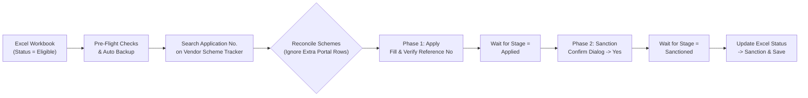

# 🏛️ PM SVANidhi — Vendor Scheme Tracker Automation Suite

[](https://svanidhi-automation.vercel.app)
[](https://sakshitiwari-24.github.io/svanidhi-automation/)
[](https://vercel.com/new/clone?repository-url=https%3A%2F%2Fgithub.com%2FSakshitiwari-24%2Fsvanidhi-automation)
[](https://www.python.org/)
[](https://playwright.dev/python/)

> [!IMPORTANT]
> **🌐 Highlighted Live URLs & Multi-System Script Hub:**
> - **🚀 Live Vercel URL:** **[https://svanidhi-automation.vercel.app](https://svanidhi-automation.vercel.app)**
> - **🌍 Live GitHub Pages Mirror:** **[https://sakshitiwari-24.github.io/svanidhi-automation/](https://sakshitiwari-24.github.io/svanidhi-automation/)**
> - **🧪 Single-Form Mock Portal:** **[https://sakshitiwari-24.github.io/svanidhi-automation/mock_portal.html](https://sakshitiwari-24.github.io/svanidhi-automation/mock_portal.html)**
> - **📦 GitHub Repository:** **[https://github.com/Sakshitiwari-24/svanidhi-automation](https://github.com/Sakshitiwari-24/svanidhi-automation)**

---

## ✨ Key Highlights & Safety Architecture

- **🛡️ Extra Portal Scheme Tolerance (`--allow-extra-portal` enabled by default):**
  Automatically ignores schemes on the portal that were already *Sanctioned* earlier or are not present in the current Excel batch, preventing false `Scheme(s) on portal but not in Excel` errors while still halting if any required Excel scheme is missing on the portal.
- **🔄 Two-Phase Verified Execution:**
  1. **Phase 1 (`Apply`):** Clicks the *Apply* icon on matching `Eligible` rows, enters the exact `Reference No`, verifies read-back character-for-character, submits, and polls until the portal confirms stage = `Applied`.
  2. **Phase 2 (`Sanction`):** Clicks the *Sanction* thumbs-up icon, verifies the confirmation modal text, confirms `Yes`, and waits until the portal stage reaches `Sanctioned`.
- **💾 Atomic Excel Persistence & Auto-Backups:**
  Creates a timestamped backup (`data.xlsx.backup-YYYYMMDD-HHMMSS.xlsx`) before every run and writes `Sanction` into the `Status` column immediately after each application completes.
- **🔤 Canonical Scheme Alias Matching:**
  Automatically normalizes naming variations across worksheets (`DFS`, `Labour`, `Health`, `Food`, `WCD`), including `PM Suraksha Bima (Yojana) For Mother/Father`.

---

## 🔄 Automation Workflow



---

## 🚀 Step-by-Step Usage Guide

> [!WARNING]
> **Before Every Run:** Always **close** `data.xlsx.xlsx` in Microsoft Excel first so Windows does not lock the file when the script writes back `Sanction` statuses.

### Step 1 — Launch Chrome in Remote Debugging Mode
Double-click **`1_START_CHROME.bat`** (or run the command below):
```bat
"C:\Program Files\Google\Chrome\Application\chrome.exe" --remote-debugging-port=9222 --user-data-dir="C:\chrome_debug_profile"
```
1. Log in to the **PM SVANidhi** portal (solve CAPTCHA / OTP).
2. Open the **Vendor Scheme Tracker** page.
3. Keep that Chrome tab open.

### Step 2 — Run a Safe Dry Run (Read-Only)
Double-click **`2_RUN_DRY_RUN.bat`** or run:
```bash
python svanidhi_automation.py --excel data.xlsx.xlsx --sheet DFS --dry-run --limit 5
```
This searches the portal, reconciles schemes, and prints the exact execution plan without modifying the portal or Excel.

### Step 3 — Run Live Automation on the Portal
Double-click **`3_RUN_ON_REAL_PORTAL.bat`** or run:
```bash
# Test on 2 applications first:
python svanidhi_automation.py --excel data.xlsx.xlsx --sheet DFS --limit 2

# Process all pending Eligible applications on the sheet:
python svanidhi_automation.py --excel data.xlsx.xlsx --sheet DFS
```

---

## 💻 Updating Across Multiple Systems

> [!TIP]
> Because this repository and the live web hub host the latest patched scripts, you can update any other PC in three easy ways:
> 1. **One-Click Auto-Updater (`0_UPDATE_SCRIPTS.bat`):** Double-click `0_UPDATE_SCRIPTS.bat` on any PC to automatically fetch the latest `svanidhi_automation.py`, `2_RUN_DRY_RUN.bat`, and `3_RUN_ON_REAL_PORTAL.bat` directly from GitHub.
> 2. **Via Browser (No Git needed):** Open the **[Live Hub URL](https://sakshitiwari-24.github.io/svanidhi-automation/)** on the other PC and click **Download `svanidhi_automation.py`** and the `.bat` files into `SwanidhinData`.
> 3. **Via Git:** Run `git pull` inside the project folder on each PC.

---

## 🛠️ Command-Line Reference (`svanidhi_automation.py`)

| Flag | Default | Description |
| :--- | :--- | :--- |
| `--excel` | `data.xlsx.xlsx` | Path to the Excel workbook |
| `--sheet` | `DFS` | Worksheet name (`DFS`, `Labour`, `Health`, `Food`, `WCD`) |
| `--cdp` | `http://127.0.0.1:9222` | Chrome DevTools Protocol endpoint |
| `--dry-run` | `False` | Read-only mode: searches and prints plan without clicking Apply/Sanction |
| `--limit` | `None` | Maximum number of applications to process in this run |
| `--app` | `None` | Process only specific Application No(s) (repeatable) |
| `--allow-extra-portal` | `True` | Ignore extra portal schemes not listed in Excel (enabled by default) |
| `--strict-portal` | `False` | Raise an error if the portal lists extra schemes not in Excel |
| `--no-prefix-check` | `False` | Disable `PMSBY` / `PMJJBY` reference number prefix sanity check |
| `--inspect APP_NO` | `None` | Print HTML table headers and row structure for selector calibration |

---

## 📁 Repository Structure

```text
├── index.html                  # Interactive Live Simulator & Multi-System Download Hub (Vercel)
├── mock_portal.html            # Standalone Single-Form Mock Portal for local Playwright testing
├── svanidhi_automation.py      # Main Vendor Scheme Tracker automation script (CDP port 9222)
├── fill_form.py                # Standalone single-form automation script with read-back verification
├── 1_START_CHROME.bat          # Launches Chrome with --remote-debugging-port=9222
├── 2_RUN_DRY_RUN.bat           # Interactive launcher for read-only dry runs
├── 2_TEST_ON_MOCK_PORTAL.bat   # Launcher for testing against mock_portal.html
├── 3_RUN_ON_REAL_PORTAL.bat    # Interactive launcher for live portal runs
├── 4_INSPECT_PORTAL.bat        # Helper to inspect portal table DOM for any Application No.
├── create_test_data.py         # Generates synthetic test Excel files (data.xlsx)
├── run_tests.py                # End-to-end automated verification test suite
└── vercel.json                 # Vercel static deployment configuration
```

> [!NOTE]
> **Privacy & Data Protection:** Real beneficiary workbooks (`data.xlsx.xlsx`), automatic backups (`*.backup-*.xlsx`), and runtime logs (`logs/`) are excluded via `.gitignore` so sensitive beneficiary data is never uploaded to GitHub or Vercel.
